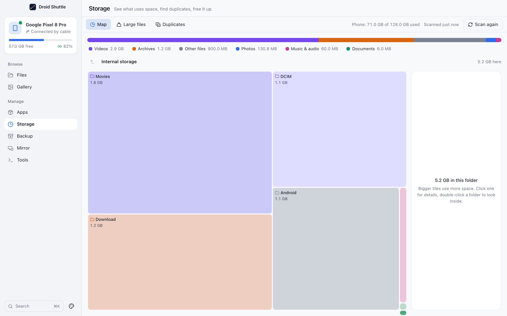
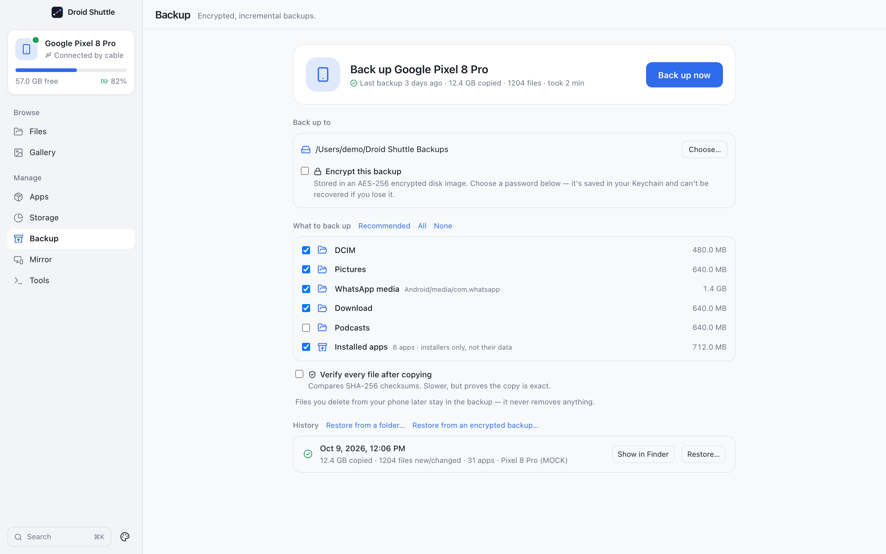

<p align="center">
  
</p>

<h1 align="center">Droid Shuttle</h1>

<p align="center">
  <strong>Free, open-source Android ⇄ Mac manager.</strong><br>
  Move files, import photos, see what is using space, back up with encryption, mirror the screen and open a shell, all over a USB cable.<br>
  Nothing to install on the phone, and the app makes no network requests of its own.
</p>

<p align="center">
  
  
  
  
  <a href="LICENSE"></a>
  <a href="https://github.com/ammarmunir4567/droid-shuttle/releases/latest"></a>
</p>

<p align="center">
  <a href="https://github.com/ammarmunir4567/droid-shuttle/releases/latest"><strong>⬇ Download for Mac</strong></a> (Apple silicon and Intel) · <a href="docs/getting-started.md">Getting started</a> · <a href="docs/README.md">Documentation</a><br>
  <sub>Not notarized by Apple yet, so macOS asks you to allow it once. <a href="#download-and-install">One command installs and allows it</a>.</sub>
</p>

<p align="center">
  <a href="docs/media/droid-shuttle-demo.mp4">
    
  </a>
  <br>
  <sub>▶ <a href="docs/media/droid-shuttle-demo.mp4">Watch the 22-second demo with sound (MP4)</a>. It shows the app's built-in demo data, not a real phone.</sub>
</p>

---

## Contents

- [Highlights](#highlights)
- [Getting started](#getting-started): [download and install](#download-and-install), [first launch](#first-launch), [build from source](#build-from-source)
- [Documentation](#documentation)
- [How it works](#how-it-works)
- [Privacy](#privacy)
- [Project status](#project-status)
- [Development](#development)
- [Contributing](#contributing)
- [License](#license)
- [Credits and third-party software](#credits-and-third-party-software)

## Highlights

| Screen | What you can do |
|---|---|
| **Files** | A two-pane file manager for phone and Mac. Drag between panes, drag out to Finder, copy and paste with Finder, F5 to copy and F6 to move. Transfers can pause, verify with SHA-256, and **continue where they stopped if you pull the cable**. |
| **Gallery** | Browse the phone's photos and videos by day or month, open them full size with zoom and camera details, and **import everything new** in one click. The app remembers what you already imported. |
| **Apps** | See installed apps with their real names and icons. Install `.apk`, `.apks`, `.xapk` and `.apkm` files by dropping them, uninstall or disable apps, force-stop, clear data and save APKs to the Mac. |
| **Storage** | Scan once, then explore a treemap, a breakdown by file type, the largest files and a **duplicate finder** that hashes on the phone. |
| **Backup** | Incremental backups of the folders you choose plus your apps' installers, optionally in an **AES-256 encrypted disk image**. Restore to the phone later. |
| **Mirror** | See the phone's screen on the Mac and control it with mouse and keyboard. Take screenshots and record the screen. |
| **Tools** | Battery, memory and device details, an interactive terminal, a filterable log viewer, and **wireless debugging** with QR or code pairing. |

On top of that: a menu-bar item with Dock progress and notifications, Quick Look for phone files, a command palette (⌘K), and three complete looks (Studio, Instrument and Soft) in light and dark.

<p align="center">
  
</p>
<p align="center">
  
  
</p>

## Getting started

### Download and install

> [!NOTE]
> **Droid Shuttle is not notarized by Apple yet.** Notarization needs a paid Apple Developer account, and this free project does not have one yet. That is why macOS blocks the first launch of a copy downloaded in a browser, and why you either allow it once in **System Settings → Privacy & Security** or run one of the one-command scripts below. The app and both scripts are open source, so you can read them first.

**Quickest: one command.** Paste this into Terminal. It downloads the right DMG for your Mac, checks it against the release's `SHA256SUMS`, copies **Droid Shuttle** into Applications and opens it. A download made this way carries no quarantine flag, so there is no first-launch block to click through:

```bash
curl -fsSL https://raw.githubusercontent.com/ammarmunir4567/droid-shuttle/main/scripts/install-droid-shuttle.sh | bash
```

No admin rights on this Mac? Add `DROID_SHUTTLE_INSTALL_DIR="$HOME/Applications"` in front of `bash` to install for your account only. The script is short; [read it](scripts/install-droid-shuttle.sh) first if you like.

**Or download the DMG yourself.** Get the DMG for your Mac from the [latest release](https://github.com/ammarmunir4567/droid-shuttle/releases/latest):

| Your Mac | File |
|---|---|
| Apple silicon (M1 or newer) | `Droid.Shuttle_<version>_aarch64.dmg` |
| Intel | `Droid.Shuttle_<version>_x64.dmg` |

Not sure which one you have? Choose **Apple menu → About This Mac**. A **Chip** line that starts with *Apple* means Apple silicon. A **Processor** line means Intel. Use a current macOS: older versions are untested (see [Requirements](#requirements)).

1. Open the DMG and drag **Droid Shuttle** onto **Applications**.
2. Open **Droid Shuttle** from Applications. The first time, macOS stops you; see below.
3. [Connect your phone](#connect-your-phone).

<a id="first-launch"></a>

#### First launch

Droid Shuttle is signed with an ad-hoc signature but is **not notarized by Apple**, which needs a paid developer account. So macOS blocks the first launch of a copy you downloaded in a browser. (The one-command installer above avoids this.) You do this once:

- **macOS 15 (Sequoia) and later.** Open the app. macOS says "Droid Shuttle" was **Not Opened**; click **Done**. Then open **System Settings → Privacy & Security**, scroll to **Security**, click **Open Anyway** next to Droid Shuttle, and confirm with your password or Touch ID.
- **macOS 14 and earlier.** Right-click the app, choose **Open**, then click **Open** in the dialog.
- **Already installed it from the DMG? One command, on any version.** With the app in Applications, paste this into Terminal. It clears the quarantine flag on Droid Shuttle only, leaves macOS's checks on for every other app, then opens Droid Shuttle:

  ```bash
  curl -fsSL https://raw.githubusercontent.com/ammarmunir4567/droid-shuttle/main/scripts/allow-droid-shuttle.sh | bash
  ```

  The script is short; [read it](scripts/allow-droid-shuttle.sh) first if you like.
- **Or by hand from Terminal, on any version:**

  ```bash
  xattr -dr com.apple.quarantine "/Applications/Droid Shuttle.app"
  ```

To check that a download is intact, compare it with `SHA256SUMS` from the same release. Run this in the folder that holds the DMG:

```bash
shasum -a 256 -c SHA256SUMS --ignore-missing
```

The app never checks for updates (it makes no network requests), so to update, download the newest DMG and drag the app over the old one.

### Connect your phone

1. On the phone, open **Settings → About phone** and tap **Build number** seven times to unlock Developer options.
2. Open **Developer options** and turn on **USB debugging**.
3. Plug the phone into the Mac and unlock it. Pull down the notification shade, tap **USB**, and choose **File transfer**.
4. When the phone asks **Allow USB debugging?**, tick **Always allow from this computer** and tap **Allow**.

Droid Shuttle detects the phone the moment it is plugged in. See [Getting started](docs/getting-started.md) for a first tour and [Troubleshooting](docs/troubleshooting.md) if the phone does not appear.

### Build from source

Prefer to build it yourself? You need the tools below, and the build takes a few minutes.

#### Requirements

| You need | Version | Notes |
|---|---|---|
| A Mac | Apple Silicon or Intel | macOS only. The app's bundle declares macOS 10.13 (Intel) and 11 (Apple silicon) as the oldest it will launch on, but it has only been tested on current macOS (the 0.1.0 DMGs were checked on macOS 27), and Mirror needs a recent WebKit. Treat older versions as untested. |
| Node.js | 22.12 or newer | With npm. |
| Rust | 1.93 or newer (stable) | Install with [rustup](https://rustup.rs). |
| Xcode Command Line Tools | any recent | `xcode-select --install` |
| An Android phone | with **USB debugging** on | Android 11 or newer is only needed for wireless pairing. |

#### Build and run

```bash
git clone https://github.com/ammarmunir4567/droid-shuttle.git
cd droid-shuttle

npm install
./scripts/fetch-adb.sh     # once: downloads Google's platform-tools and bundles adb
npm run tauri dev          # starts the app with hot reload
```

> [!IMPORTANT]
> Run `./scripts/fetch-adb.sh` before your first build or `cargo` command. The app ships `adb` as a sidecar, and the Rust build stops with `resource path binaries/adb-… doesn't exist` if it is missing.

To produce a `.app` and a `.dmg`:

```bash
npm run tauri build                                              # for this Mac's architecture
# or a universal (Apple Silicon + Intel) build:
rustup target add x86_64-apple-darwin
npm run tauri build -- --target universal-apple-darwin --bundles app,dmg
```

The results are under `src-tauri/target/release/bundle/` (or `src-tauri/target/universal-apple-darwin/release/bundle/` for the universal build). An app you build yourself opens normally. A copy you send to someone else hits the [first-launch prompt](#first-launch).

More detail, including tests and the browser-only mock mode, is in [Development](docs/development.md).

## Documentation

| Guide | What it covers |
|---|---|
| [Getting started](docs/getting-started.md) | Requirements, building, connecting a phone, a first tour |
| [Files](docs/user-guide/files.md) | Two panes, transfers, drag and drop, clipboard, resume after unplugging |
| [Gallery](docs/user-guide/gallery.md) | Browsing, the viewer, importing, the imported ledger |
| [Apps](docs/user-guide/apps.md) | Installing, uninstalling, saving APKs, bundles |
| [Storage](docs/user-guide/storage.md) | Scanning, the map, large files, duplicates |
| [Backup](docs/user-guide/backup.md) | What is backed up, encryption, incremental logic, restore |
| [Mirror](docs/user-guide/mirror.md) | Mirroring, input, screenshots and recording |
| [Tools](docs/user-guide/tools.md) | Device status, terminal, logcat, wireless debugging |
| [Menu bar and notifications](docs/user-guide/menu-bar.md) | Menu-bar mode, Dock progress, closing the window |
| [Appearance and command palette](docs/user-guide/appearance.md) | The three looks, brightness, ⌘K |
| [Keyboard shortcuts](docs/user-guide/keyboard-shortcuts.md) | Every shortcut in one place |
| [Troubleshooting](docs/troubleshooting.md) | Connection problems, errors and what they mean |
| [Privacy and data](docs/privacy-and-data.md) | What is stored where, what is sent (nothing), permissions |
| [Architecture](docs/architecture.md) | How the app is built |
| [Development](docs/development.md) | Building, testing, releasing, conventions |

## How it works

- **No companion app.** Droid Shuttle talks to the phone through Android's own tooling, using **ADB** (the Android Debug Bridge).
- **Its own ADB client.** The Rust backend speaks the ADB server protocol directly to `127.0.0.1:5037`, which gives instant hot-plug detection and fast transfers without starting a process for every call. A copy of Google's `adb` is bundled so nothing else needs installing.
- **Mirroring** uses the server from [scrcpy](https://github.com/Genymobile/scrcpy), bundled unmodified, and decodes the video in the app window.
- **Everything else** is stock Android shell commands (`pm`, `dumpsys`, `find`, `stat`, `sha256sum`, `logcat`, …) run over ADB.

The full picture, with diagrams, is in [Architecture](docs/architecture.md).

## Privacy

Droid Shuttle makes **no network requests of its own** and has **no telemetry, analytics or update checks**. Your files go straight between the phone and the Mac. The only web address it can open is the Apple Maps link behind **Show location in Maps** in the Gallery viewer, and only when you click it. Details are in [Privacy and data](docs/privacy-and-data.md).

## Project status

Droid Shuttle is at **version 0.1.0**. It is a young project built for macOS, and it has been developed against a small number of phones, so expect rough edges.

Things worth knowing before you rely on it:

- **Deleting from the phone is permanent.** Android has no Trash over USB. Delete dialogs say so. Moves between the phone and the Mac (F6, ⌘-drag, cut and paste) delete the originals once the copy succeeds, without a second prompt.
- **Mirror is video only.** There is no audio and no multi-touch. Secure apps, such as banking apps, appear black because Android blocks capturing them.
- **Storage scans are not saved.** The scan lives in memory until you quit the app.
- **macOS only.** The app uses native macOS features (the Keychain, `hdiutil`, Quick Look, native drag and drop). Windows and Linux are not supported.

Each guide lists the limits that apply to its screen.

## Development

```bash
npm run dev          # the interface in a browser with a built-in mock phone (port 1420)
npm run tauri dev    # the real app
npm run build        # type-check and build the frontend
npm run test:unit    # Vitest
npm run test:e2e     # Playwright against the mock phone
cd src-tauri && cargo test
```

Tech stack: **Tauri 2** (Rust) · **React 19** · **TypeScript** · **Vite** · **Tailwind CSS 4** · **Zustand** · **TanStack Query** · **Radix UI** · **xterm.js**.

```text
src/            React interface: screens in features/, shell and looks, typed bridge in lib/api.ts
src-tauri/      Rust backend: ADB client, transfer engine, backup, storage, mirror, tools
tests/e2e/      Playwright tests that run against the browser mock
scripts/        fetch-adb.sh
brand/          app icon and menu-bar icon sources
docs/           documentation and media
```

See [Development](docs/development.md) for the complete workflow.

## Contributing

Contributions are welcome. Start with [CONTRIBUTING.md](CONTRIBUTING.md).

## License

Droid Shuttle is released under the [MIT License](LICENSE).

## Credits and third-party software

- **[scrcpy](https://github.com/Genymobile/scrcpy)** by Genymobile and Romain Vimont: the unmodified server v4.1 that powers Mirror (Apache License 2.0).
- **Android platform-tools** by Google: the bundled `adb` (Apache License 2.0, with additional notices shipped in the app).
- Full notices live in [`src-tauri/resources/NOTICE.md`](src-tauri/resources/NOTICE.md) and are bundled inside the app.
- Interface built with [Tauri](https://tauri.app), [React](https://react.dev), [Radix UI](https://www.radix-ui.com), [Lucide](https://lucide.dev) icons, [xterm.js](https://xtermjs.org), IBM Plex Sans and Nunito.
- The demo video was made with the `/brag` skill and [Hyperframes](https://hyperframes.heygen.com/). Music: "Happy Beats / Business Moves" by [ende.app](https://ende.app/en). Sound effects by [Kenney](https://kenney.nl/) (CC0). See [`docs/media`](docs/media/README.md).
