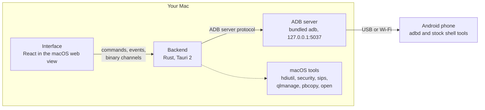
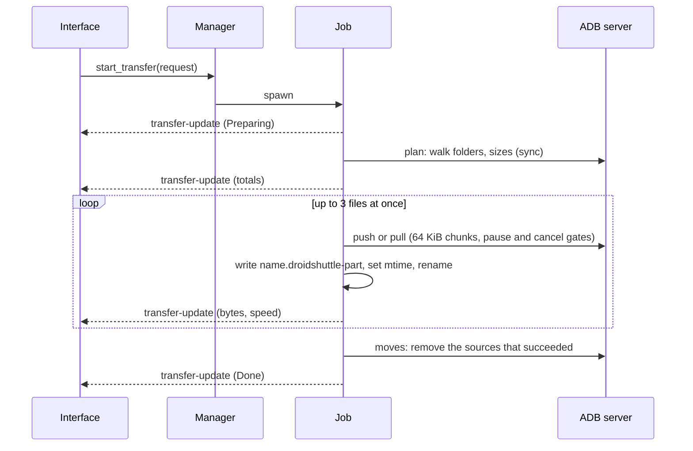
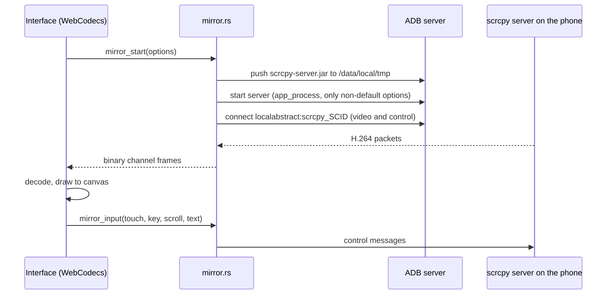

# Architecture

How Droid Shuttle is put together. Read this before changing the backend, the bridge between the interface and Rust, or the transfer engine. Everything here describes version 0.1.0.

## Contents

- [The big picture](#the-big-picture)
- [Design decisions](#design-decisions)
- [Repository layout](#repository-layout)
- [The interface](#the-interface)
- [The bridge](#the-bridge)
- [The Rust backend](#the-rust-backend)
- [Talking to the phone](#talking-to-the-phone)
- [The transfer engine](#the-transfer-engine)
- [Feature pipelines](#feature-pipelines)
- [Looks and design tokens](#looks-and-design-tokens)
- [State and persistence](#state-and-persistence)
- [Testing architecture](#testing-architecture)
- [Adding a screen](#adding-a-screen)

## The big picture



- The **interface** is a React single-page app shown in a Tauri window (the macOS web view, WebKit).
- The **backend** is a Rust library (`droid_shuttle_lib`) that exposes 87 named commands to the interface, owns all long-running work, and pushes progress back as events.
- The backend talks to the phone **through the ADB server**, using its own client for the ADB protocol. It does not shell out to `adb` for normal work.
- Everything the app learns about the phone comes from **stock Android tools** run over ADB. There is no app on the phone.

## Design decisions

| Decision | Why |
|---|---|
| **ADB only, no companion app on the phone.** | Nothing to install or keep in sync, and the phone stays untouched. A consequence: features that need an on-phone app (contacts, messages, call logs) are out of scope. |
| **Speak the ADB server protocol directly** (`adb/mod.rs`). | No process per call, and `host:track-devices-l` gives instant hot-plug detection. `adb` is still used where a program is simpler: `start-server`, `install`, and the `tcpip` step of Go wireless. |
| **Bundle `adb` as a Tauri sidecar** (`externalBin`). | The app works without Android Studio or Homebrew. The app prefers the bundled `adb` and falls back to Homebrew's. |
| **Embed the scrcpy server** with `include_bytes!` and verify its SHA-256. | Mirroring needs no download. The client and server versions must match exactly, so the pair is updated together. |
| **Pointer-based drag and drop** (`lib/drag.ts`), not HTML5 drag and drop. | It does not clash with Tauri's native handling of files dropped from Finder, and it supports modifiers, spring-loaded folders and a custom drag chip. |
| **Native drag-out through `NSFilePromiseProvider`** (`native_drag.rs`). | Phone files are *promised*: nothing is copied until the drop lands. |
| **Write files atomically** (`.droidshuttle-part`, then rename). | A half-copied file never has its final name, and an interrupted copy can resume. |
| **One component library, three looks**, driven by CSS tokens. | Restyling the whole app never touches component code. |
| **A mock backend in the browser** (`lib/api.ts`). | The interface can be developed and tested end to end with no phone and no Rust. |
| **macOS only.** | Keychain, `hdiutil`, Quick Look, `NSFilePromiseProvider` and the window vibrancy are macOS features. |

## Repository layout

```text
src/
  main.tsx, App.tsx          entry point; device and event wiring; chooses what to render
  nav.ts                     the screens and their descriptions (single source of truth)
  shell/                     window structure per look: Studio sidebar, Instrument rail, Soft top bar
  features/<screen>/         one folder per screen: files, gallery, apps, storage, backup, mirror, tools
  components/                CommandPalette, ConnectionGuide, Dialogs, Toaster, TransferTray
  lib/                       api.ts (the bridge and mock), ops.ts, drag.ts, clipboard.ts, dual.ts, mirror.ts, logcat.ts, …
  store/                     Zustand stores
  theme/                     looks (variants.ts) and appearance persistence
  brand/                     logo component and brand colours
  index.css                  design tokens for all three looks
src-tauri/
  src/lib.rs                 the 87 commands and run()
  src/adb/                   ADB client, sync protocol, in-process fake server for tests
  src/device/                discovery, hot-plug, device info
  src/transfer/              transfer engine
  src/{fs,media,apps,remote_zip,storage,backup,mirror,tools,menubar,native_drag,store}.rs
  resources/                 scrcpy server, NOTICE.md
  binaries/                  adb sidecars (fetched, git-ignored)
  tauri.conf.json, capabilities/default.json, Cargo.toml
tests/e2e/                   Playwright tests against the browser mock
scripts/fetch-adb.sh
brand/                       icon and tray icon sources
```

## The interface

- **`main.tsx`** renders `<App/>` inside a TanStack Query provider, applies the saved look before first paint, and marks the page as non-vibrant when it is not running inside Tauri.
- **`App.tsx`** loads the device list, subscribes to `devices-changed` and `adb-error`, turns `tray-navigate` events into screen changes, turns `transfer-update` events into toasts and housekeeping, sets `data-section` on `<html>` (used by the Soft look), and renders either the **connection guide** (when no phone is ready) or the chosen screen.
- **`nav.ts`** defines the seven screens, their group (**Browse** or **Manage**), icon and one-line description. The sidebar, rail, top bar and command palette all read it.
- **`shell/`** holds the three navigation structures. `Shell.tsx` picks one by look; `Nav.tsx` has the sidebar, rail, top bar, status bar and device card.
- **`features/`** has one folder per screen. Files is the largest (panes, path bar, places, toolbar, function bar, drag layer, shortcuts hook). Storage has pure modules (`treemap.ts`, `dupes.ts`, `categories.ts`) with unit tests.
- **`components/`** are the pieces shared across screens: `TransferTray` (rendered by the shell, so it shows on every screen), `Dialogs` (promise-based confirm, conflict and APK dialogs), `Toaster`, `CommandPalette` (cmdk) and `ConnectionGuide`.
- **`lib/ops.ts`** is the single entry point for every copy, move, drop and paste. It resolves conflicts, asks for confirmation, and starts jobs.

## The bridge

`src/lib/api.ts` is a typed wrapper around the backend. Every method is written as:

```ts
inTauri ? invoke("snake_case_command", { … }) : /* mock */
```

where `inTauri` is `"__TAURI_INTERNALS__" in window`. Streaming commands wrap a Tauri `Channel`, and event subscriptions use `listen()` (a no-op in the browser).

In a plain browser the **mock** provides one fake phone ("Pixel 8 Pro", serial `MOCK123`), a mock file tree, 600 media items, 12 apps, a storage tree with duplicates, a log stream, a shell and device status. It also records calls and exposes hooks for tests, which are only installed outside Tauri:

| Hook | Purpose |
|---|---|
| `window.__calls` | Every bridge call as `{ name, args }`, recorded by `rec()` |
| `window.__emitTransfer(snapshot)` | Simulate a `transfer-update` event |
| `window.__storageProgress(progress)` | Simulate a long storage scan |
| `window.__shellEmit(text)` | Terminal output |
| `window.__logPush(text)` | Log lines |

### Events and channels

| Event | From | Meaning |
|---|---|---|
| `devices-changed` | `device/mod.rs` | The phone list changed (hot-plug) |
| `adb-error` | `device/mod.rs` | The ADB server cannot be reached |
| `transfer-update` | `transfer/mod.rs` | A snapshot of one job (progress, status, errors) |
| `app-meta` | `apps.rs` | A name and icon were resolved |
| `backup-stage` | `backup.rs` | A backup moved to its next stage |
| `backup-done` | `backup.rs` | A backup ended (the interface does not currently listen for it) |
| `tray-navigate` | `menubar.rs` | A menu-bar item asked for a screen |
| `mirror-clipboard` | `lib.rs` | The phone's clipboard text changed |
| `mirror-ended` | `lib.rs` | A mirroring session ended |
| `media-changed` | `lib.rs` | The Gallery index or ledger changed |
| `storage-progress` | `lib.rs` | A storage scan's progress |

Three commands stream **binary channels**:

| Channel | Payload |
|---|---|
| `shell_start` → `on_out` | `[kind: u8][bytes]`, kind 1 = stdout, 2 = stderr, 3 = exit |
| `logcat_start` → `on_lines` | UTF-8 batches of newline-terminated lines |
| `mirror_start` → `on_video` | `[kind: u8][pts: u64 big-endian][payload]`. Kind 0 = session (width and height as u32), 1 = SPS/PPS config, 2 = key frame, 3 = delta frame |

## The Rust backend

`lib.rs` defines the 87 commands and `run()`. Each command is a thin function that calls a module and turns errors into strings. `run()` first migrates old data folders, then creates the menu-bar item, starts the device tracker, empties the clipboard staging folder, prunes cached originals on a background thread, and installs the window-close and Dock-reopen handling.

| Module | Responsibility |
|---|---|
| `adb/mod.rs` | Async client for the ADB server protocol on `127.0.0.1:5037`: connect (and start the server if needed), list devices, state parsing, the bundled-or-Homebrew `adb` lookup |
| `adb/sync.rs` | The sync protocol: list, stat, push, pull. Uses `LIS2` and `STA2` (64-bit sizes) when the phone offers them. One connection per operation |
| `adb/fake.rs` | An in-process fake ADB server for unit tests, including a "cable pulled" simulation (tests only) |
| `device/mod.rs` | Device discovery, live hot-plug tracking (`host:track-devices-l`), device info |
| `fs.rs` | Listing and basic operations on the phone and on the Mac |
| `transfer/` | The transfer engine and its pause and cancel handle |
| `media.rs` | The Gallery: MediaStore index, thumbnails, originals, EXIF |
| `store.rs` | The local SQLite database and the migration from the old name |
| `apps.rs`, `remote_zip.rs` | The app manager, and a `Read + Seek` view of a remote file that reads only the needed parts of an APK |
| `storage.rs` | The storage scan, in-memory size tree, categories and duplicate finder |
| `backup.rs` | Incremental backup and restore, encryption with `hdiutil` and the Keychain |
| `mirror.rs` | Screen mirroring and control with the scrcpy server, screenshots and recording |
| `tools.rs` | Interactive shell, logcat, device status, wireless debugging |
| `menubar.rs` | The menu-bar item, Dock progress and notifications. The menu's content comes from pure functions that are unit tested |
| `native_drag.rs` | Native macOS drag-out and clipboard (`NSFilePromiseProvider`, `NSPasteboard`) |

The 87 commands, by area:

- **Devices and files:** `list_devices`, `device_info`, `list_dir`, `list_local`, `device_places`, `device_volumes`, `local_home`, `device_mkdir`, `local_mkdir`, `device_rename`, `local_rename`, `device_delete`, `local_trash`, `reveal_in_finder`, `open_local`, `preview_device_file`, `preview_local_file`
- **Transfers:** `check_conflicts`, `start_transfer`, `pause_transfer`, `resume_transfer`, `cancel_transfer`, `clear_finished_transfers`, `install_apk`
- **Clipboard and drag:** `native_drag`, `clipboard_write`, `clipboard_read`, `clipboard_stage`
- **Tools:** `shell_start`, `shell_write`, `shell_resize`, `shell_close`, `logcat_start`, `logcat_stop`, `logcat_clear`, `pids_of_package`, `device_status`, `save_text`, and the wireless set `wifi_mdns`, `wifi_pair`, `wifi_connect`, `wifi_disconnect`, `wifi_go_wireless`, `wifi_qr`, `wifi_qr_finish`
- **Mirror:** `mirror_start`, `mirror_input`, `mirror_stop`, `phone_screenshot`, `record_start`, `record_stop`, `record_active`
- **Apps:** `apps_list`, `apps_resolve`, `app_details`, `app_uninstall`, `app_set_enabled`, `app_clear_data`, `app_force_stop`, `app_launch`, `app_open_settings`, `app_extract`, `apps_install`
- **Backup:** `backup_folders`, `backup_folder_size`, `backup_encrypted_status`, `backup_run`, `backup_cancel`, `backup_running`, `backup_history`, `backup_open`, `backup_close`, `backup_restore_files`, `backup_restore_apps`
- **Gallery:** `media_scan`, `media_list`, `media_thumb`, `media_open`, `media_info`, `media_import`
- **Storage:** `storage_scan`, `storage_cancel`, `storage_summary`, `storage_children`, `storage_largest`, `storage_duplicates`, `storage_forget`

## Talking to the phone

- **Connection.** `connect()` first tries a TCP connection to `127.0.0.1:5037`. If something answers, it is used as is. Otherwise the app finds an `adb` (next to the executable first, then `/opt/homebrew/bin/adb` and `/usr/local/bin/adb`), runs `adb start-server`, and retries for up to three seconds.
- **Discovery.** A background task keeps a `host:track-devices-l` request open, so the full device list arrives on every change. On an error it emits `adb-error` and retries every two seconds.
- **Device states** are `ready`, `unauthorized`, `offline`, `recovery`, `sideload` and `other`. A serial containing `:` or `_adb-tls-connect` is a wireless device.
- **Files** use the sync protocol over the server (one connection per operation).
- **Commands** use `shell:` and `exec:` services. The interactive terminal uses the shell protocol v2 with a pseudo-terminal.
- **Mirroring** connects to the scrcpy server's abstract socket through the ADB server (`host:transport:<serial>` then `localabstract:scrcpy_<id>`), so no `adb forward` is created.
- **Where the `adb` program itself runs:** `start-server`; `install` and `install-multiple` (for APK installs and restores); and `tcpip 5555` in Go wireless. Wireless pairing, connecting and mDNS use ADB server services instead.

## The transfer engine

`transfer/mod.rs` turns "copy these things there" into a job that streams files with bounded parallelism and survives a cable pull.



Key facts:

| Topic | Detail |
|---|---|
| Parallelism | `PARALLEL_FILES = 3` per job, enforced by a semaphore inside each job. There is no global queue, so jobs from different actions run concurrently. |
| Directions | `pull` (phone → Mac), `push` (Mac → phone), and same-side copy and move. Same-side work runs sequentially through `cp` and `mv`, without byte progress. |
| Planning | Folders are walked recursively, symlinks resolved, empty directories created first. Totals come from this pre-scan. |
| Conflicts | `Skip`, `Replace`, `KeepBoth` and `Update` (skip when the size is equal and the modified time within 2 s, used by Backup and Restore). `KeepBoth` names are `name (2).ext`. |
| Atomic writes | Suffix `.droidshuttle-part`. Always for pulls. For pushes only at `ATOMIC_PUSH_MIN` = 16 MiB. |
| Verification | After a file, `sha256sum` on the phone is compared with the hash of the streamed bytes. A mismatch deletes the copy. Skipped when the phone's output is unusable. |
| Pause and cancel | A shared handle (`transfer/ctl.rs`) is checked between 64 KiB chunks. |
| Moves | Copy first, then delete the sources of files that succeeded. Nothing is deleted after a cancel. |
| Speed | Sampled every 100 ms and smoothed (0.8 old + 0.2 new). |
| Errors | Up to 50 per job are kept. |

### Surviving a cable pull

An I/O error of a disconnect kind (`UnexpectedEof`, `ConnectionReset`, `BrokenPipe`, `TimedOut`, and similar), or an ADB message such as "device … not found" or "offline", moves the job to the **waiting** state instead of failing it. The engine polls until the same serial is ready again, waits 400 ms, and retries the step, up to `MAX_RECONNECTS` = 50 times per step. Disk-full and permission errors on the Mac are deliberately not treated as disconnects.

Each file resumes independently:

- A **pull** continues from the `.droidshuttle-part` file when it is at least `MIN_RESUME` = 1 MiB, shorter than the source, and the source's size and modified time are unchanged. The existing part is re-hashed, any torn tail is truncated, and the rest is fetched with `tail -c +N`.
- A **push** continues when the file is at least 16 MiB (so it used a partial file), the partial file on the phone is at least 1 MiB and shorter than the source, and the source size is unchanged. The rest is appended with `cat >>`, and the modified time is set with `touch -d`.

Resume lives in memory in the running job. There is no persisted queue.

## Feature pipelines

### Gallery

`content query` over the MediaStore image and video tables → rows upserted into the `media` table (rows not seen again are deleted) → the grid reads from the local index. Thumbnails: an EXIF preview from the first 256 KiB for large JPEGs, then a full pull (six at a time) and a downscale (`image` crate; `sips` for HEIC and RAW), with the phone's own thumbnail as a fallback. Videos use the phone's frame extractor, two at a time. Import writes to the `imports` ledger for each successful file.

### Apps

`dumpsys package packages`, `pm list packages -f` and `dumpsys diskstats` run in parallel and are merged. Names and icons come from `remote_zip`, a `Read + Seek` implementation that fetches 256 KiB blocks with `dd`, so the `apk-info` parser can read an APK's directory, manifest, resources and one icon without the whole package. Bundles (`.apks`, `.apkm`, `.xapk`) are unpacked and installed with `install-multiple`, choosing the splits that match the phone's ABI and screen density.

### Storage

One streaming `find … -exec stat -c '%s %Y %n'` builds an in-memory size tree (`Scan`). The map, the categories and the largest-files list are answered from it. Duplicates group by size, then hash the first MiB, then hash the whole file, all with `sha256sum` on the phone. Deleting goes through the normal delete command and `Scan::remove` keeps the tree in step.

### Backup

Folders are pulled into `files/` with the `Update` conflict rule; APKs go into `apps/`; `apps.json` and `backup.json` are written. Encryption creates a sparse bundle with `hdiutil create … -encryption AES-256 -stdinpass`, stores the password in the Keychain with `security`, mounts it privately for the run, and detaches it afterwards.

### Mirror



### Tools and the menu bar

`tools.rs` runs the shell, logcat and wireless services. `menubar.rs` builds the tray menu from pure functions (`menu_model`, `title`, `finished_message`), so what the menu says is unit tested without a display.

## Looks and design tokens

`src/index.css` defines **three complete identities** (Studio, Instrument, Soft) selected by `:root[data-variant="…"]`. Components read only tokens such as `--bg-solid`, `--panel`, `--surface-2`, `--nav-*`, `--border`, `--fg`, `--fg-muted`, `--hover`, `--selected`, `--color-accent`, `--color-ok`, `--color-warn`, `--color-danger`, `--accent-ink`, `--shadow-*` and `--radius-*`. Light and dark use `light-dark()` and the `data-theme` attribute. Brand colours and the storage category hues are shared by all looks. Soft adds `--sec-<screen>` accent colours selected by `data-section`.

`theme/variants.ts` describes each look (navigation style `sidebar`, `rail` or `top`, and the numeric row heights that virtualized lists need), and `theme/appearance.ts` persists the choice. Tailwind CSS 4 is wired in with `@tailwindcss/vite`.

## State and persistence

| What | Where |
|---|---|
| Server-like data (directory listings, apps, media, device info, storage children) | TanStack Query (`staleTime` 5 s, one retry, refetch on focus) |
| Device list and selection | `store/devices.ts` (Zustand) |
| Current screen | `store/nav.ts`, not persisted |
| Toasts, promise-based dialogs, the transfer map | `store/ui.ts` |
| Files panes, selection, history, clipboard | `store/files.ts` |
| Gallery, Backup, Storage screens | `store/gallery.ts`, `store/backup.ts`, `store/storage.ts` |
| Look and brightness | `theme/appearance.ts` |
| Remembered options | the web view's local storage, keys starting with `db.` |
| Photo index, imported list, backup history, app names | SQLite, `droidshuttle.db` |
| Thumbnails, icons, opened originals | `~/Library/Caches/ai.arqanum.droidshuttle/` |

## Testing architecture

Three layers, each cheap to run without a phone:

- **Vitest** for pure TypeScript (log parsing, mirror key mapping, the treemap, the duplicate-keep rule).
- **Playwright** against the browser build with the mock backend, asserting on both the screen and the recorded bridge calls (`window.__calls`).
- **`cargo test`** for the backend, using the in-process fake ADB server (`adb/fake.rs`), which scripts the ADB host protocol, the sync protocol and a few shell commands, and can simulate a pulled cable. Tests that need a real phone are `#[ignore]`d.

See [Development](development.md#testing) for commands and counts.

## Adding a screen

1. **`src/nav.ts`:** add the id to `SectionId` and an entry to `SECTIONS`. The sidebar, rail, top bar, command palette and menu-bar navigation validation pick it up. A new group name also needs the `group` type and the groups list in `Nav.tsx` updated.
2. **`src/features/<name>/<Name>View.tsx`:** the screen.
3. **`src/App.tsx`:** add a branch to the screen chain (before the final fallback).
4. **`src/index.css`:** add `--sec-<id>` and a `[data-section="<id>"]` rule so the Soft look has a colour for it.
5. **`src/lib/api.ts`:** add the types and `inTauri ? invoke : mock` wrappers. Use `rec()` for mock calls that tests assert on.
6. **Rust:** add `src-tauri/src/<name>.rs`, `mod <name>;` in `lib.rs`, `#[tauri::command]` functions, and list them in `generate_handler!`. Add `.manage(…)` for shared state. New plugin permissions go in `capabilities/default.json`.
7. **Optional:** the menu-bar's "go to" list in `menubar.rs`, which is a fixed list of four screens, with its unit test.
8. **Tests:** a spec in `tests/e2e/`, and add the screen to the list in `tests/e2e/brand.spec.ts`.
