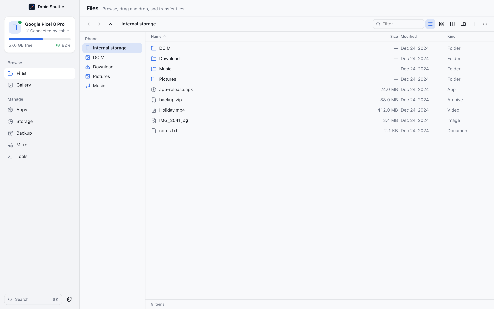

# Getting started

This page takes you from a download to a connected phone. If you would rather build the app yourself, see [Building from source](#building-from-source) at the end.

## 1. Install the app

Download the DMG for your Mac from the [latest release](https://github.com/ammarmunir4567/droid-shuttle/releases/latest):

| Your Mac | File |
|---|---|
| Apple silicon (M1 or newer) | `Droid.Shuttle_<version>_aarch64.dmg` |
| Intel | `Droid.Shuttle_<version>_x64.dmg` |

Not sure which one you have? Choose **Apple menu → About This Mac**. A **Chip** line that starts with *Apple* means Apple silicon. A **Processor** line means Intel. Use a current macOS: older versions are untested (see [What you need](#what-you-need)).

Open the DMG and drag **Droid Shuttle** onto **Applications**. You do **not** need Android Studio or a separate copy of `adb`: Droid Shuttle bundles Google's platform-tools.

### First launch

Droid Shuttle is signed with an ad-hoc signature but is **not notarized by Apple**, which needs a paid developer account. macOS therefore blocks the first launch of a downloaded copy. You only do this once:

- **macOS 15 (Sequoia) and later.** Open the app. macOS says "Droid Shuttle" was **Not Opened**; click **Done**. Open **System Settings → Privacy & Security**, scroll to **Security**, click **Open Anyway** next to Droid Shuttle, and confirm with your password or Touch ID.
- **macOS 14 and earlier.** Right-click the app, choose **Open**, then click **Open** in the dialog.
- **From Terminal, on any version:**

  ```bash
  xattr -dr com.apple.quarantine "/Applications/Droid Shuttle.app"
  ```

  This removes the quarantine flag that the browser put on the download, so macOS stops asking.

### Check the download (optional)

Every release includes a `SHA256SUMS` file. Put it in the same folder as the DMG and run:

```bash
shasum -a 256 -c SHA256SUMS --ignore-missing
```

It should print `OK` next to the DMG you downloaded.

## 2. Prepare the phone

You only do this once per phone.

1. Open **Settings → About phone**, then tap **Build number** seven times. Android tells you that Developer options are on.
2. Open **Developer options** (its location in Settings varies by phone; searching Settings for "Developer options" finds it) and turn on **USB debugging**.
3. Connect the phone to the Mac with a USB cable and unlock the screen.
4. Pull down the notification shade, tap the **USB** notification, and choose **File transfer**.
5. The phone asks **Allow USB debugging?**. Tick **Always allow from this computer** so it does not ask again, then tap **Allow**.

Droid Shuttle's own **Connect your Android phone** screen shows the same short steps while it waits.

## 3. What the connection screen tells you

Until a phone is ready, the app shows a guide in place of the screens:

| You see | It means | Do this |
|---|---|---|
| **Connect your Android phone** and "Waiting for a device…" | No phone detected. | Plug it in with a USB cable and unlock the screen. Follow the numbered steps on screen. |
| **Allow this Mac on your phone** | The phone sees the Mac but has not approved it. | Tap **Allow** on the phone's **Allow USB debugging?** prompt, and tick **Always allow from this computer**. |
| **Device is offline** (or *recovery*, *sideload*, *other*) | The phone is connected in a state the app cannot use. | Unplug and reconnect the cable, then unlock the phone. |
| **Can't reach the ADB service** | The app could not talk to an ADB server. | See [Troubleshooting](troubleshooting.md#cant-reach-the-adb-service). |

The device card at the top of the sidebar shows the phone's name, **Connected by cable** (or **Connected over Wi-Fi**), the free storage as a bar, and the battery level. While the phone waits for approval it reads **Waiting for approval**; with no phone it reads **No phone** and **Plug one in with a cable**.

Plugging in a second phone adds it to a **Switch phone** menu on the device card. The whole app works on the phone you select.

## 4. A first tour

<p align="center">
  
</p>

1. **Look around.** The sidebar has seven screens in two groups: **Files** and **Gallery** under *Browse*, and **Apps**, **Storage**, **Backup**, **Mirror** and **Tools** under *Manage*. The app opens on **Files**.
2. **Show the Mac next to the phone.** In the Files toolbar, click **Show Mac side by side**. The Mac appears as a second pane, starting in your home folder.
3. **Copy a file.** Click a file in the phone pane and press **F5** (or click **Copy to Mac** in the bar at the bottom). On a Mac keyboard you may need to hold **Fn** for F5.
4. **Watch the transfer.** A transfer tray appears at the bottom of the window. Pause, cancel or collapse it from there.
5. **Find what uses space.** Open **Storage** and click **Scan phone storage**. Scanning only reads the phone.
6. **Press ⌘K.** The command palette jumps to any screen and switches the look.

From here, the user guide pages describe each screen in depth: [Files](user-guide/files.md), [Gallery](user-guide/gallery.md), [Apps](user-guide/apps.md), [Storage](user-guide/storage.md), [Backup](user-guide/backup.md), [Mirror](user-guide/mirror.md) and [Tools](user-guide/tools.md).

## 5. Updating

- **The app:** Droid Shuttle never checks for updates, because it makes no network requests. Download the newest DMG from the [releases page](https://github.com/ammarmunir4567/droid-shuttle/releases) and drag the app over the old one in Applications. Your settings and history are kept.
- **`adb`:** each release bundles the platform-tools version that was current when it was built. If you build from source, `./scripts/fetch-adb.sh` downloads the latest one, so the version is not pinned.

## 6. Removing the app

To uninstall, quit the app (menu-bar item → **Quit**) and drag **Droid Shuttle** to the Trash. The app stores its data in `~/Library/Application Support/ai.arqanum.droidshuttle`, `~/Library/Caches/ai.arqanum.droidshuttle` and (for remembered settings) `~/Library/WebKit/ai.arqanum.droidshuttle`. To start from scratch, delete those folders too. [Privacy and data](privacy-and-data.md) lists everything that is stored and where.

## Building from source

### What you need

| You need | Details |
|---|---|
| A Mac | Apple Silicon or Intel. The app is macOS only. The bundle declares macOS 10.13 (Intel) and 11 (Apple silicon) as the oldest it will launch on, but it has only been tested on current macOS (the 0.1.0 DMGs were checked on macOS 27), and the Mirror screen needs a WebKit that supports WebCodecs. Treat older versions as untested. |
| Node.js 22.12 or newer | The toolchain (Vite 8, Vitest 5) requires it. |
| Rust 1.93 or newer | The newest dependency in the lockfile requires it. Install with [rustup](https://rustup.rs). |
| Xcode Command Line Tools | `xcode-select --install`. The build compiles C code (SQLite) and uses `lipo` and `codesign`. |
| An Android phone and a USB cable | **USB debugging** must be on. Android 11 or newer is only required for wireless pairing. |

### Build and run

```bash
git clone https://github.com/ammarmunir4567/droid-shuttle.git
cd droid-shuttle

npm install
./scripts/fetch-adb.sh
npm run tauri dev
```

What each step does:

- `npm install` installs the JavaScript dependencies. Rust crates download on the first build.
- `./scripts/fetch-adb.sh` downloads `platform-tools-latest-darwin.zip` from `dl.google.com`, extracts `adb`, and writes three ad-hoc signed sidecars to `src-tauri/binaries/`: one each for Apple Silicon and Intel, plus Google's universal binary. It also copies Google's notice file. You only need to run it once, and again whenever you want a newer `adb`.
- `npm run tauri dev` builds the Rust backend and starts the interface with hot reload.

> [!IMPORTANT]
> Run `fetch-adb.sh` before the first build. Without the sidecar, the Rust build fails with `resource path binaries/adb-aarch64-apple-darwin doesn't exist`. This applies to `tauri dev`, `tauri build`, `cargo build`, `cargo check` and `cargo test` alike.

#### Building an app bundle

```bash
npm run tauri build
```

This produces `Droid Shuttle.app` and a `.dmg` for your Mac's architecture under `src-tauri/target/release/bundle/`.

For a universal build that runs natively on Apple Silicon and Intel:

```bash
rustup target add x86_64-apple-darwin
npm run tauri build -- --target universal-apple-darwin --bundles app,dmg
```

The output is under `src-tauri/target/universal-apple-darwin/release/bundle/`. To build a DMG for one architecture, pass `--target aarch64-apple-darwin` or `--target x86_64-apple-darwin` instead; [Development](development.md#packaging) shows how the release DMGs are made.

The app is **ad-hoc signed** (`signingIdentity` is `-`) and **not notarized**. An app you built yourself opens normally. If you give the `.app` or `.dmg` to someone else, they will see the [first-launch prompt](#first-launch).
