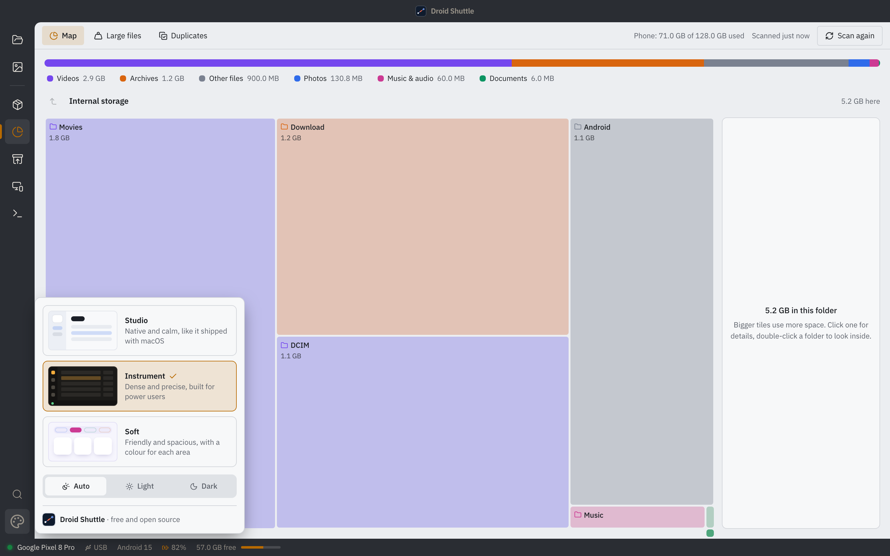
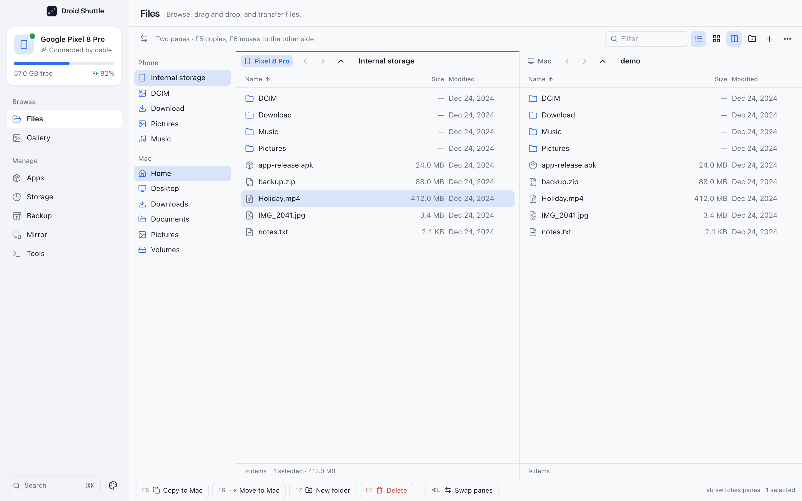
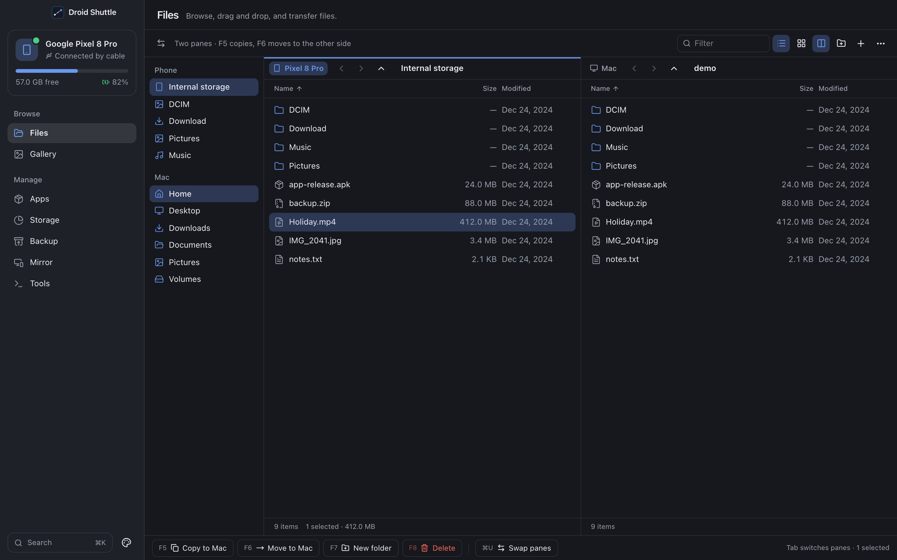
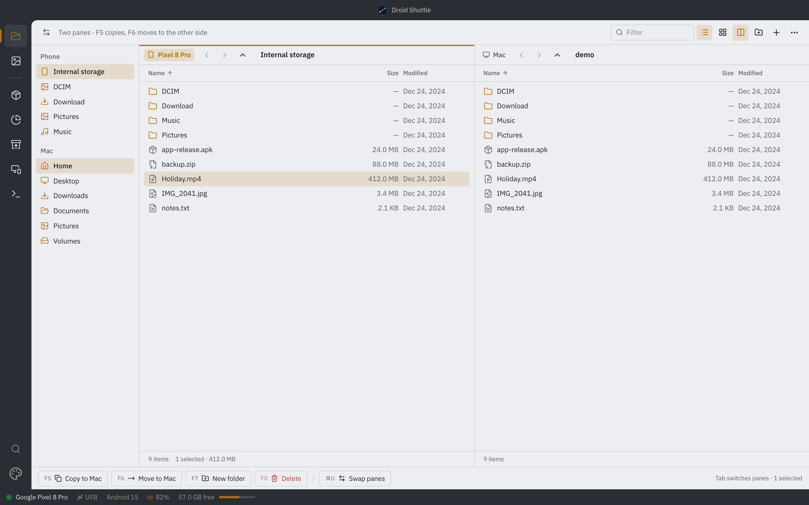
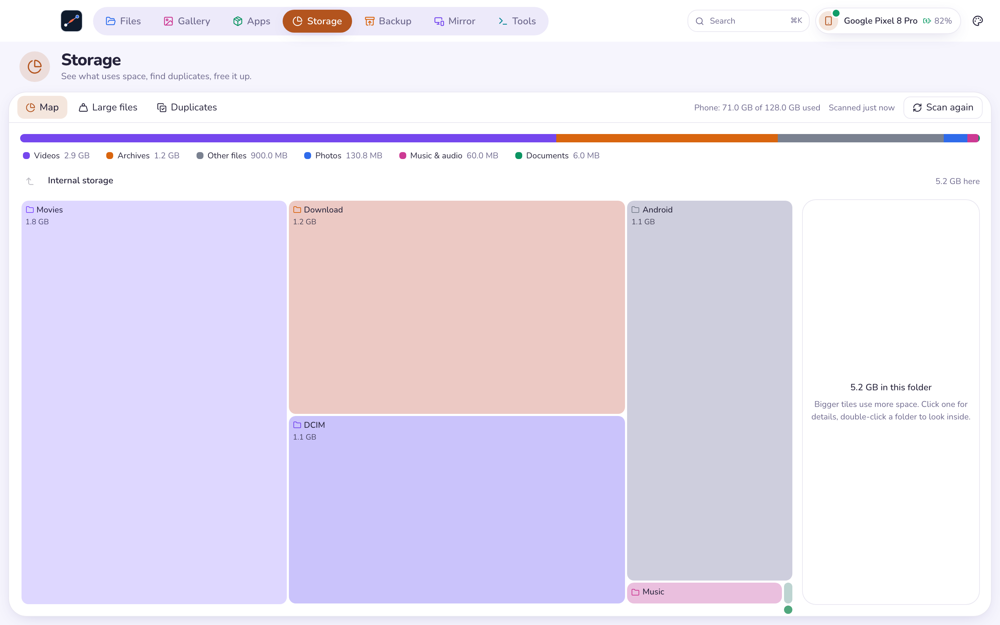
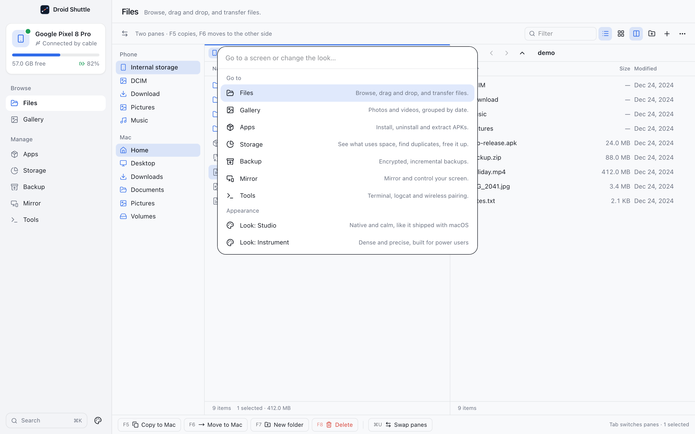

# Appearance and command palette

Droid Shuttle ships **three complete looks**, each in **light and dark**, and a **command palette** that jumps to any screen and switches the look from the keyboard.

## Contents

- [Choosing a look](#choosing-a-look)
- [Studio](#studio)
- [Instrument](#instrument)
- [Soft](#soft)
- [Brightness](#brightness)
- [The command palette](#the-command-palette)
- [The window](#the-window)

## Choosing a look

Open the **Appearance** menu (the palette icon) or use the [command palette](#the-command-palette). The menu has a **Look** group with a preview card for each look, a **Brightness** group (**Auto**, **Light**, **Dark**), and the line "Droid Shuttle · free and open source".

  

Where the Appearance button is depends on the look: bottom of the sidebar in **Studio**, bottom of the icon rail in **Instrument**, and the far right of the top bar in **Soft**. Your choice is remembered (`db.appearance` in the app's local storage) and applied before the first frame is drawn. The default is **Studio** with **Auto** brightness.

All three looks share the same components. Each one defines its own colours, type, corner radii, spacing and shadows through design tokens, so changing the look restyles everything without changing behaviour.

## Studio

*"Native and calm, like it shipped with macOS."* The default.

- A **232 px sidebar** with the wordmark by the traffic lights, the device card, the **Browse** and **Manage** groups, and a **Search ⌘K** button.
- The sidebar is translucent over the window's vibrancy. Studio is the only look where the window background shows through.
- System font (SF), 13 px text, blue accent.

  
  

## Instrument

*"Dense and precise, built for power users."*

- A slim **56 px icon rail**, dark in both light and dark modes, with tooltips instead of labels.
- A **status bar** at the bottom that always shows the phone's status dot and name, **USB** or **Wi-Fi**, `Android <version>`, battery percentage, and free space with a bar.
- Content sits in a panel with a rounded corner. There is no per-screen title header.
- IBM Plex Sans, 12.5 px text, tight rows, and an **amber accent** (the colour of a USB charging LED).

  

## Soft

*"Friendly and spacious, with a colour for each area."*

- A **top bar** with the app icon, pill tabs for the seven screens, a **Search ⌘K** pill, a device pill with name and battery, and the Appearance button.
- A large title with the screen's description, and content in a rounded card.
- Nunito, 14 px text, rounded corners, and a **different accent colour for each screen**: Files blue, Gallery pink, Apps green, Storage brown-orange, Backup orange, Mirror purple, Tools teal.

  

## Brightness

| Choice | Meaning |
|---|---|
| **Auto** | Follow the macOS appearance (shown as **Brightness: Match the system** in the command palette) |
| **Light** | Always light |
| **Dark** | Always dark |

One exception: the **Terminal** tab in Tools picks its colours from the macOS setting when it opens and ignores this override.

## The command palette

Press **⌘K** (or Ctrl+K) anywhere in the app. It also opens from the **Search** button (**Search and commands**), the magnifier on the Instrument rail, or the **Search** pill in Soft. Press **Esc** to close it.

  

The placeholder reads "Go to a screen or change the look…". It contains exactly these commands, and it filters as you type:

**Go to**

| Command | Description shown |
|---|---|
| **Files** | Browse, drag and drop, and transfer files. |
| **Gallery** | Photos and videos, grouped by date. |
| **Apps** | Install, uninstall and extract APKs. |
| **Storage** | See what uses space, find duplicates, free it up. |
| **Backup** | Encrypted, incremental backups. |
| **Mirror** | Mirror and control your screen. |
| **Tools** | Terminal, logcat and wireless pairing. |

**Appearance**

- **Look: Studio**, **Look: Instrument**, **Look: Soft**
- **Brightness: Match the system**, **Brightness: Light**, **Brightness: Dark**

With no matches it says **Nothing matches that**. The palette searches these commands only; it does not search files, apps or devices, and it has no action commands (such as taking a screenshot).

Choosing a screen when no phone is ready still works; you land on the connection guide.

## The window

- One window, **1280 × 820** by default and at least **960 × 600**.
- An **overlay title bar**: the traffic lights float over the content, and headers and bars are draggable.
- Only Studio shows the window's translucent vibrancy; Instrument and Soft paint a solid background.
- Dropping files from Finder onto the window is supported on every screen (see [Files](files.md#in-from-finder)).
