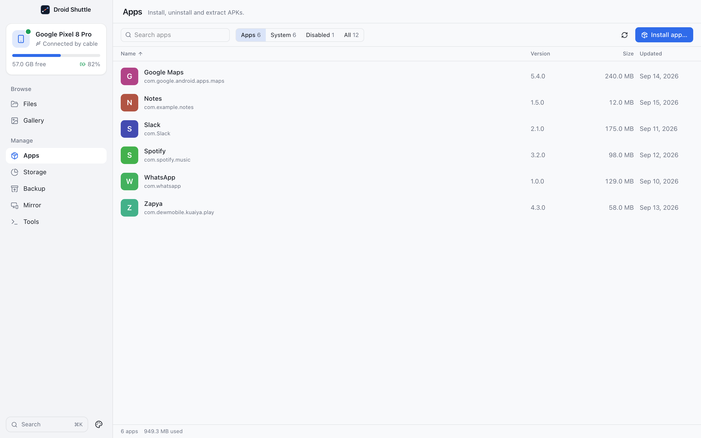

# Apps

**Install, uninstall and extract APKs.** The Apps screen lists what is installed on the phone, with real names and icons, and manages apps without touching the phone.

  

## Contents

- [The list](#the-list)
- [Names and icons](#names-and-icons)
- [App details](#app-details)
- [Installing apps](#installing-apps)
- [Saving APKs](#saving-apps-apks)
- [Uninstalling, disabling and clearing data](#uninstalling-disabling-and-clearing-data)
- [Several apps at once](#several-apps-at-once)
- [Limits](#limits)

## The list

The app reads three things from the phone at once (`dumpsys package packages`, `pm list packages -f` and `dumpsys diskstats`) and shows every package installed for the main user that has an APK on disk.

- **Tabs:** **Apps** (user-installed), **System**, **Disabled** (user and system apps that are turned off) and **All**, each with a count.
- **Search:** matches the display name or the package name, ignoring case.
- **Sort:** click the **Name**, **Size** or **Updated** column header; click again to reverse. Name starts ascending, the others descending. **Version** is not sortable.
- **Each row** shows the icon, the name, **System** and **Disabled** badges, the package name, the version, the app size and the update date. Sizes that the phone does not report show as "—".
- **Footer:** `N apps`, and on the **Apps** tab the total space used by the apps and their data.
- The list refreshes when it is older than 30 seconds, after every action, and with the refresh button.

## Names and icons

Android stores an app's name and icon inside its APK, which can be 200 MB. Droid Shuttle does not download the whole package. It reads only the parts it needs through a ranged connection (256 KiB blocks fetched with `dd` over ADB): the ZIP directory, `AndroidManifest.xml`, `resources.arsc` and the one icon. The code estimates that as 5 to 15 percent of the APK.

- Visible rows are resolved in batches of up to 24, three at a time, and fill in as they arrive.
- The icon is a PNG, WebP or JPEG from the package, or for adaptive and vector icons the best matching bitmap. It is scaled to at most 96×96.
- Until a name is known, the row shows a guess made from the package name, and a coloured square with the first letter in place of an icon.
- Results are cached: labels in the local database (valid while the app's version code is unchanged), icons in `~/Library/Caches/ai.arqanum.droidshuttle/icons/`. Failures are not cached.

## App details

Select exactly one app to open a details panel with the large icon, name and package name, and these buttons:

| Button | What it does |
|---|---|
| **Open** | Launches the app on the phone. If it has no launchable screen: "This app has no launchable screen". |
| **Force stop** | Stops it (`am force-stop`). |
| **Save APK…** | Copies the app's APK files to the Mac. See [Saving APKs](#saving-apps-apks). |
| **Phone settings** | Opens that app's settings page on the phone. |
| **Disable** / **Enable** | `pm disable-user --user 0` or `pm enable`. Disabling asks nothing. |
| **Clear data…** | After a confirmation, erases the app's data (`pm clear`). |
| **Uninstall…** | See below. System apps show **Remove for this user…**. |

The panel also shows: Version (`versionName (versionCode)`), Target SDK, Installed, Updated, **Source** (Google Play, Galaxy Store, Amazon Appstore, the installer's package name, or **Sideloaded / unknown**), App size, Data, Cache and the package file paths on the phone. **Permissions (N allowed, M denied)** is a collapsible list of the app's *runtime* permissions: allowed ones in green, denied ones struck through.

## Installing apps

There are three ways to install:

1. Click **Install app…** and pick files. The picker allows several files at once and accepts `.apk`, `.apks`, `.xapk` and `.apkm`.
2. **Drag files from Finder onto the Apps screen.** Dropping something that is not an app package shows "Drop .apk, .xapk, .apks or .apkm files here to install them".
3. Drop them on the Files screen's phone side and choose **Install** in the dialog (see [Files](files.md#installing-apps-by-dropping-them)).

A toast shows `Installing name…` and then `Installed name`, or `name: reason`. Apps are installed one after another.

| Format | How it is installed |
|---|---|
| `.apk` | `adb install -r`: installs or upgrades, keeping data. |
| `.apks`, `.apkm` | Unpacked to a temporary folder. The base APK and the split APKs that fit the phone (its CPU architectures and screen density) are installed together with `adb install-multiple -r`. Only **English** language splits are kept; other language splits in the bundle are dropped. |
| `.xapk` | Unpacked, and every APK inside is installed. Any `.obb` expansion files are then copied to `/sdcard/…` in the path they have inside the bundle (for example `Android/obb/<package>/`). Errors in that last step are ignored. |

The temporary folder is deleted afterwards. Failures are translated into plain language, for example:

- "A newer version of this app is already installed. Uninstall it first to install an older one."
- "This app is signed differently from the installed copy. Uninstall the installed app first (its data will be lost)."
- "The phone blocked the install. Enable “Install via USB” in Developer options, then try again."
- "The install was declined on the phone. Approve the prompt on the screen and try again."

Anything the app does not recognise shows the phone's own error line.

## Saving apps (APKs)

**Save APK…** (or **Save APKs…** for several) opens a folder picker titled **Save APKs to…** and copies the app's package files there.

- A normal app becomes `<name>_<version>.apk`.
- An app with split APKs gets its own folder, `<package>-<version>/`, holding every file under its on-device name (`base.apk`, `split_config.….apk`, …).
- Existing files are never overwritten (names get ` (2)`). Progress shows in the transfers tray. There is no checksum verification.

A saved split folder cannot be reinstalled with **Install app…**, which only takes single files. [Backup](backup.md) can install such sets when it restores.

## Uninstalling, disabling and clearing data

**A normal app.** **Uninstall…** asks `Uninstall “name”?` ("The app will be removed from your phone.") with the checkbox **Keep the app's data and settings**. Buttons: **Cancel** and **Uninstall**.

**A system app.** The button reads **Remove for this user…**. The dialog says "This is a system app. It will be removed for your user account and may break features that depend on it. A factory reset brings it back. Disabling it instead is easier to undo." Buttons: **Cancel** and **Remove**. There is no keep-data option. Disabling is the gentler choice.

**Clear data…** asks `Clear all data for “name”?` and says "Accounts, settings and saved files inside the app are erased. This can't be undone."

## Several apps at once

Select with ⌘-click or Ctrl-click, or ⇧-click for a range. A bar shows `N selected`, **Save APKs…**, **Uninstall…** and a clear button.

**Bulk uninstall** asks `Uninstall N apps?`, lists the first six names (then "and N more"), and offers **Keep apps' data and settings**. It uninstalls one by one and shows an error toast for each failure.

System apps are never removed in bulk. If the selection contains only system apps you get **System apps aren't removed in bulk — select them one at a time.** In a mixed selection they are skipped without a message.

## Limits

- The **Size** column shows only the app's own size, but sorting by size and the footer total also include the app's data.
- The permission list covers runtime permissions only.
- Names and icons exist only for apps that have been resolved so far. A backup's list of apps can therefore contain empty names (the restore list then shows the package name).
- **Disable** does not ask for confirmation.
