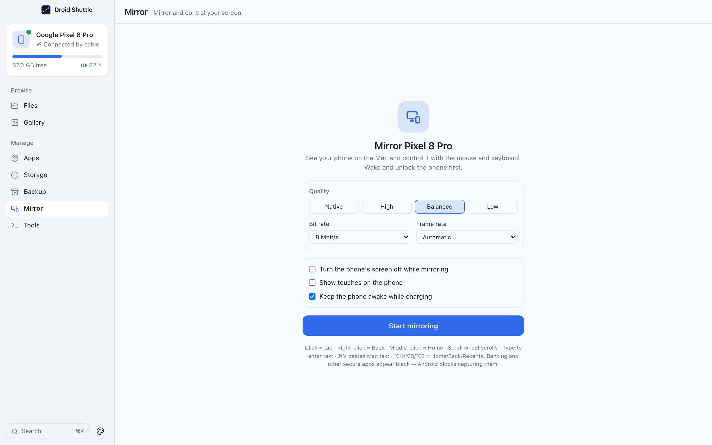

# Mirror

**Mirror and control your screen.** See the phone's screen in a window on the Mac and control it with the mouse and keyboard. Take screenshots and record the screen.

  

## Contents

- [How it works](#how-it-works)
- [Starting and stopping](#starting-and-stopping)
- [Options](#options)
- [Controlling the phone](#controlling-the-phone)
- [The side toolbar](#the-side-toolbar)
- [Screenshots and recording](#screenshots-and-recording)
- [What is put on the phone](#what-is-put-on-the-phone)
- [If it does not work](#if-it-does-not-work)
- [Limits](#limits)

## How it works

Mirror uses the server from [scrcpy](https://github.com/Genymobile/scrcpy) (v4.1, Apache-2.0), bundled unmodified inside the app and verified against its published SHA-256. The server runs on the phone, encodes the screen as **H.264**, and injects the touch and key events the app sends. The app talks to it **through the ADB server** (`localabstract:`), so no port forwarding is created. The video is decoded in the app window with the **WebCodecs `VideoDecoder`** and drawn on a canvas.

Mirror needs:

- **A ready phone:** USB debugging on and the Mac authorized. Until the phone is ready, the app shows the connection guide instead of this screen.
- **An awake, unlocked phone.** A black or off screen produces no frames.
- **A web view with WebCodecs.** If it is missing, the error reads "This version of macOS can't decode the phone's video in the app window."

The code enforces no minimum Android version for Mirror.

## Starting and stopping

- **Start:** click **Start mirroring** on the start screen (**Mirror {model}**, "See your phone on the Mac and control it with the mouse and keyboard. Wake and unlock the phone first.").
- **While connecting** the overlay reads **Connecting to {model}…** with a **Cancel** button. If no picture arrives after 4 seconds it adds "Still waiting for the phone's screen. If it's off or locked, wake it up." and a **Wake phone** button.
- **Stop:** the **Stop mirroring** button (the X) at the bottom of the side toolbar. Mirroring also stops when you leave the Mirror screen. If the phone is unplugged or the server dies, a toast says **Mirroring ended** (or shows the server's error).
- Starting again first stops any session that is still running.

## Options

Set these on the start screen. They are remembered.

| Option | Choices | Default |
|---|---|---|
| **Quality** (maximum length of the longer side) | **Native**, **High** (1920), **Balanced** (1280), **Low** (800) | **Balanced** |
| **Bit rate** | 4, 8, 16, 32 Mbit/s | 8 Mbit/s |
| **Frame rate** | **Automatic**, **Up to 60 fps**, **Up to 30 fps** | **Automatic** |
| **Turn the phone's screen off while mirroring** | on / off | off |
| **Show touches on the phone** | on / off | off |
| **Keep the phone awake while charging** | on / off | on |

Only options that differ from the server's defaults are sent. Audio is always off, and there is no audio setting.

## Controlling the phone

Click the picture to focus it. Everything below applies while it has focus.

| Do this | The phone gets |
|---|---|
| Left-click and drag | One-finger touch: tap, swipe, long press. Pointer capture keeps a drag going outside the window. |
| Right-click | **Back** (wakes the screen if it is off) |
| Middle-click | **Home** |
| Scroll wheel, trackpad scroll | Scroll |
| Typing a character | Text input |
| Enter, Backspace, Tab, Delete, arrows, Home, End, Page Up, Page Down | The matching Android key. Hold ⇧ for the shifted version. |
| Esc | **Back** |
| ⌘V | Pastes your Mac's clipboard text into the phone |
| ⌥H / ⌥B / ⌥S | Home / Back / Recents |
| ⌥P | Power |
| ⌥O | Turn the phone's screen off or on |
| ⌥R | Rotate |
| ⌥N / ⌥⇧N | Notification panel / Quick Settings panel |
| ⌥↑ / ⌥↓ | Volume up / down |

Other ⌘ and Ctrl shortcuts are not forwarded; they stay with the Mac. **Clipboard from the phone to the Mac** is automatic: when the phone's clipboard changes, its text is copied to the Mac clipboard and a toast says **Copied from your phone to the Mac clipboard**. ⌘C itself is not forwarded.

The start screen sums it up: "Click = tap · Right-click = Back · Middle-click = Home · Scroll wheel scrolls · Type to enter text · ⌘V pastes Mac text · ⌥H/⌥B/⌥S = Home/Back/Recents. Banking and other secure apps appear black — Android blocks capturing them."

## The side toolbar

A toolbar labelled **Phone controls** sits beside the picture:

| Button | Does |
|---|---|
| **Home (⌥H)**, **Back (⌥B, right-click)**, **Recent apps (⌥S)** | Navigation keys |
| **Volume up (⌥↑)**, **Volume down (⌥↓)**, **Power (⌥P)** | Hardware keys |
| **Notifications (⌥N)**, **Rotate (⌥R)** | As above |
| **Turn phone screen off (⌥O)** / **Turn phone screen on** | The phone's display only; mirroring continues |
| **Screenshot** | See below |
| **Record screen** / **Stop recording** | See below |
| **Keep window on top** / **Stop keeping window on top** | Pins the Droid Shuttle window above others |
| **Full screen** / **Exit full screen** | |
| **Stop mirroring** | Ends the session |

A small button at the bottom right of the picture (the frame rate) toggles an overlay with the picture size and `N fps`.

## Screenshots and recording

**Screenshot** runs `screencap` on the phone and saves `~/Pictures/Droid Shuttle Screenshots/Screenshot YYYY-MM-DD HH.MM.SS.png`. A toast says **Screenshot saved** with **Show in Finder**. If the phone returns nothing: "The phone didn't return a screenshot (is the screen off or the app blocking captures?)."

**Record screen** runs `screenrecord` on the phone. It does not record the mirrored video.

- It uses the **Bit rate** from the start screen and shows the elapsed time.
- Android limits one recording to **3 minutes**. At 178 seconds the app stops it and says "Android limits a single recording to 3 minutes — saving it now."
- When you stop, the file is copied to `~/Movies/Droid Shuttle/Screen Recording YYYY-MM-DD HH.MM.SS.mp4` and removed from the phone. A toast says **Recording saved** with **Show in Finder**.
- The recording is made on the phone at `/sdcard/Download/.droidshuttle-recording-<id>.mp4` until it has been copied.

> [!IMPORTANT]
> Stop a recording before you leave the Mirror screen. Leaving does not stop it; the recording keeps running on the phone, and the file is left on the phone because it is only copied when you stop from the toolbar.

## What is put on the phone

- Each time you start mirroring, the scrcpy server is copied to `/data/local/tmp/scrcpy-server.jar` (mode 0644). The app does **not** delete it afterwards, so it stays there until you remove it or the phone clears that folder. The server *process* runs only while mirroring.
- Recordings use a temporary file in `/sdcard/Download/` as described above.
- Nothing is installed as an app.

## If it does not work

| Message | What it means |
|---|---|
| "The phone isn't reachable." | The server reported the device as offline or missing. Reconnect the cable. |
| "Your phone blocked screen control. On some phones (Xiaomi/Redmi, OPPO, Vivo) enable “USB debugging (Security settings)” in Developer options." | The phone refused injected input. Turn on the extra toggle your phone's Developer options offers. |
| "Mirroring server version mismatch. …" | The bundled server and client disagree. Reinstall Droid Shuttle. |
| "The bundled scrcpy server is corrupted — reinstall Droid Shuttle." | The checksum of the bundled server did not match. |
| "The phone sent an unexpected video format." / `Unexpected video codec "…"` | The phone is not sending H.264. |
| "Video decoder: …" | The Mac's decoder failed; the app asks the phone for a fresh key frame. |
| The picture stays black | The screen is off or locked, or the app on screen blocks capture (banking apps do). Use **Wake phone**. |

See [Troubleshooting](../troubleshooting.md) for more.

## Limits

- **Video only.** No audio, no multi-touch or pinch gestures, and no drag-and-drop file install.
- Keys that are not a single character (emoji, composed input) are not sent.
- **Keep window on top** and **Full screen** are not reset when you leave the screen; the window can stay pinned or full-screen.
- Switching the selected phone while mirroring does not stop the session; the picture keeps showing the original phone. Stop mirroring before you switch.
- The menu-bar item's **Take Phone Screenshot** uses the first ready phone, not necessarily the selected one.
