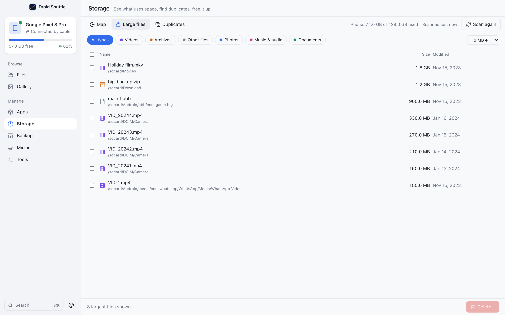

# Storage

**See what uses space, find duplicates, free it up.** The Storage screen scans the phone's shared storage once, then answers every question from that scan without touching the phone again, except when it hashes files to find duplicates.

  

## Contents

- [Scanning](#scanning)
- [Map](#map)
- [File types](#file-types)
- [Large files](#large-files)
- [Duplicates](#duplicates)
- [Deleting](#deleting)
- [Limits](#limits)

## Scanning

The first time you open Storage, it explains what a scan does:

> **See what's using your phone's space**
> Droid Shuttle reads the file list once and draws a map of your storage. Then you can find big files and duplicates. Scanning only reads; nothing changes.

Click **Scan phone storage**.

- The scan runs one streamed command on the phone: `find /sdcard/ -type f -exec stat -c '%s %Y %n' {} +`. It lists files and reads their size, modified time and path. It **changes nothing**.
- It always covers **shared storage** (`/sdcard`): "the same files you see in Files. App data and system files aren't included." Hidden files and folders are included. Folders the phone refuses to list are skipped silently.
- While it runs the banner says **Scanning your phone…** with `N files · size`, updated every 200 ms, and the button becomes **Stop**. There is no time estimate.
- When it finishes, the header shows **Scanned just now** (later `N min ago`, `N h ago`, `N d ago`) and the button becomes **Scan again**.
- The header also shows `Phone: X of Y used`. That figure comes from the phone's own report, not the scan, so the scan's total will be smaller.

The scan lives in memory in the app. It survives switching screens or phones during the session, but it is **lost when you quit**; scan again after relaunching. The Map, Large files and Duplicates tabs are disabled until a scan exists.

## Map

A **squarified treemap** of the current folder, with tile area proportional to bytes.

- Folders are a soft tint of the file type that fills them most. Files are solid colours by type.
- Each folder level shows at most 300 children. The rest are folded into one non-clickable tile named `N smaller items`, so the totals still add up. Empty folders are not shown.
- **Navigate:** double-click a folder (or press Enter on it) to open it. The breadcrumb starts at **Internal storage**, the up button is **Up one folder**, and the folder's total reads `N here`.
- **Details panel:** click a tile to see its name, path, size, `Share: X% of this folder`, and for folders `Contains N files`; for files the kind and modified date. Buttons: **Open folder** (folders), **Show in Files**, **Delete…**. With nothing selected it says "Bigger tiles use more space. Click one for details, double-click a folder to look inside."
- If a folder is deleted while you are inside it, the view steps back out. A folder that is gone shows **This folder is empty or was deleted.**

## File types

A stacked bar above the map splits the scan by file type. Each legend entry (name and size) is a button that opens **Large files** filtered to that type.

Classification is by **file extension only** (case-insensitive). A name with no extension is **Other files**.

| Category | Extensions |
|---|---|
| **Photos** | jpg, jpeg, png, gif, webp, heic, heif, bmp, dng, raw, cr2, nef, arw, avif |
| **Videos** | mp4, mov, mkv, avi, webm, 3gp, m4v, mpg, mpeg |
| **Music & audio** | mp3, m4a, aac, wav, flac, ogg, opus, amr, wma |
| **Documents** | pdf, doc, docx, xls, xlsx, ppt, pptx, txt, rtf, odt, csv, epub, md |
| **Archives** | zip, rar, 7z, tar, gz, bz2, xz, tgz |
| **App packages** | apk, xapk, apks, aab |
| **Other files** | everything else |

## Large files

  

A table of the **300 largest files** (the request is capped at 2000 by the backend): name with its folder, size and modified date. Folders are not listed here.

- **Type chips:** **All types** plus one chip per category that has files.
- **Minimum size:** **Any size**, **10 MB +** (default), **100 MB +** or **1 GB +**.
- Tick rows (or **Select all**) and use **Delete…**. The footer shows `N selected · size` and `N largest files shown`.
- A **Show in Files** icon appears on each row when you hover.

## Duplicates

Finds files that are byte-for-byte identical, so you can keep one copy. It needs a scan first (otherwise: "Scan the phone first").

The start screen says:

> **Find identical files**
> Finds photos, videos and documents that exist more than once, so you can keep one copy. Files are compared by content, not by name, and nothing is deleted until you confirm.

Choose **Smallest file to check** (**100 KB +**, **1 MB +** by default, or **10 MB +**) and click **Find duplicates**.

How it works, all on the phone, so nothing is downloaded for hashing:

1. **Same size.** Scanned files at or above the minimum are grouped by exact size. Only groups of two or more continue.
2. **Quick fingerprint.** For each candidate the phone hashes the **first 1 MiB** (`head -c 1048576 file | sha256sum`), in batches of at most 100 files or 512 MiB. Files are regrouped by size plus fingerprint.
3. **Full hash.** The survivors are hashed completely with `sha256sum`, in batches of at most 40 files or 256 MiB.
4. Files with the same full hash form a **set**. Sets are sorted by wasted space (`size × (copies − 1)`), largest first.

Progress reads **Looking for files of the same size…**, then **Comparing the start of each file…**, then **Checking that copies are identical · X of Y** with a bar, and "Your phone does the hashing, so big videos take a while. Nothing is changed." **Cancel** is checked between batches, so a very large batch can delay it.

**Results.** The header reads `N sets of identical files · X wasted`. Each set shows `N copies · X each`, a **Clean up this set** checkbox and a radio button per copy to choose which one to keep; each copy is labelled **Keep** (green) or **Delete** (red), with a **Show in Files** icon. **Which copy to keep** sets the default for all sets: **Keep the oldest** (default), **Keep the newest** or **Keep the shortest path**. You can override it per set, and untick **Clean up this set** to leave a set alone.

> [!NOTE]
> **One copy of every set is always kept.** The app deletes every file in a set *except* the one you choose to keep. There is no way to mark all copies of a set for deletion.

The button reads `Delete N copies · free X…`, or **Nothing to delete** when it is disabled. If nothing is found, you see **No duplicates found** and "Every file of <size> or more is unique." Results are held in memory and reset on a rescan or when you change phone.

The app excludes no folders: the candidates are every file the scan found.

## Deleting

Deleting from the Map, Large files or Duplicates always asks first:

> **Delete “name” (size) from your phone?** (or **Delete N items (size) from your phone?**)
> Android has no Trash for files deleted over USB. This can't be undone.

Buttons: **Cancel** (focused) and **Delete**.

- Deletes are **permanent**: `rm -rf` on the phone, in chunks of 50 paths. Folders are deleted recursively.
- On success the in-memory scan removes those paths, so the totals, the type bar and the map update **without a rescan**. A toast says `Deleted … · freed X`. The "freed" figure is the sum of the sizes from the scan, not a fresh measurement.
- On failure: `Couldn't delete: …`, and the scan is not changed.
- The Files screen refreshes. The `Phone: X of Y used` figure and the Gallery list do not update until they are refreshed.

## Limits

- Only `/sdcard` is scanned.
- The scan is not saved between launches.
- **Large files** shows the 300 biggest only.
- Duplicate detection compares a SHA-256 of the whole file (after the quick fingerprint). It does not compare byte by byte beyond that hash.
- A file that disappears between the scan and the hashing is silently left out.
