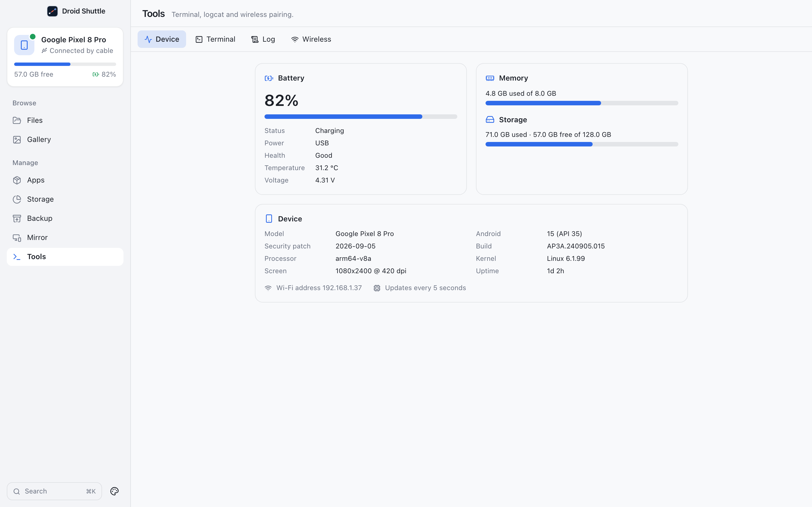
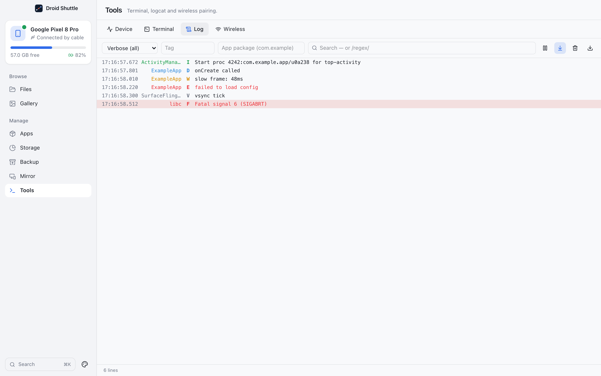
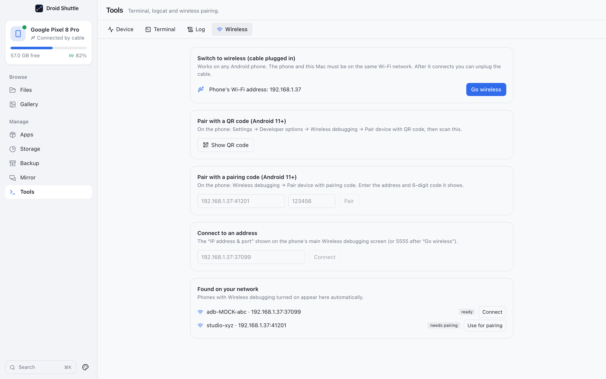

# Tools

**Terminal, logcat and wireless pairing.** The Tools screen has four tabs: **Device**, **Terminal**, **Log** and **Wireless**. Only the active tab is running; switching away closes the terminal session and the log stream.

## Contents

- [Device](#device)
- [Terminal](#terminal)
- [Log](#log)
- [Wireless](#wireless)

## Device

  

A live dashboard that refreshes every 5 seconds ("Updates every 5 seconds").

| Card | Shows |
|---|---|
| **Battery** | The level as a large percentage (the bar turns red at 15 % or less), **Status** (Charging, Discharging, Not charging, Full, Unknown), **Power** (AC charger, USB, Wireless, Not plugged in), **Health** (Good, Overheating, Dead, Over voltage, Failure, Cold, Unknown), **Temperature** in °C and **Voltage**. |
| **Memory** | `X used of Y`, from the phone's memory report. |
| **Storage** | `X used · Y free of Z`, from `df` on the data partition. Bars turn red above 90 %. |
| **Device** | **Model** (manufacturer and model), **Android** (`version (API n)`), **Security patch**, **Build**, **Processor**, **Kernel**, **Screen** (`1080x2400 @ 420 dpi`) and **Uptime**. |

A footer shows **Wi-Fi address** and the phone's IP, or **Not connected to Wi-Fi**. The address is read from the `wlan0` interface only.

## Terminal

An interactive shell on the phone, drawn with [xterm.js](https://xtermjs.org) (13 px monospace, 5000 lines of scrollback).

- It uses the ADB **shell protocol v2** with a pseudo-terminal (`TERM=xterm-256color`), so colours, line editing, `top`, `vi` and window resizing work.
- When the shell ends, the terminal prints `[shell exited with code N]` and a bar says **The shell ended.** with a **New shell** button. A failure to open prints `Couldn't open a shell: …`.
- The terminal's colours follow the macOS light or dark setting at the moment it opens. They ignore the app's own Light or Dark override.

## Log

A live **logcat** viewer. (The tab is named **Log**.)

  

- It runs `logcat -v threadtime -b main,system,crash` on the phone. The **main**, **system** and **crash** buffers are included; others are not. The phone's recent buffer is replayed when you open the tab. Lines that do not parse (such as `--- beginning of main`) are dropped.
- Levels are colour-coded: V muted, D blue, I green, W amber, E and F red, with fatal rows tinted.

From left to right the controls are:

| Control | Does |
|---|---|
| **Minimum level** | **Verbose (all)**, **Debug and up**, **Info and up**, **Warning and up**, **Error and up**, **Fatal and up** |
| **Filter by tag** | Case-insensitive match on the tag |
| **Filter by app package** (`com.example`) | Shows only that app's lines. The app looks up its process IDs every 4 seconds; the footer says `showing PID …` or `app isn't running`. |
| **Search log** | Case-insensitive text over tag and message. Type `/pattern/` for a case-insensitive regular expression (an invalid pattern falls back to plain text). |
| **Pause** / **Resume** | Holds new lines and shows `Paused — N new lines waiting`; resuming appends them. |
| **Follow new lines** | Scrolls with the log. It switches off by itself when you scroll up. |
| **Clear log** | Clears the view **and runs `logcat -c`**, which clears the phone's log buffers. |
| **Export log** | Saves the lines that are currently shown (after your filters) as plain text, by default `logcat.txt`. Toast: `Saved N lines`. |

The view keeps the newest **50 000** lines. The footer reads `N lines` or `N lines of M` when filtered. The buffer is discarded when you leave the tab.

## Wireless

  

Use the phone over Wi-Fi instead of a cable. The phone and the Mac must be on the same network. The sections appear in this order:

**Connected wirelessly** (only when a wireless phone is connected). Each row shows the model and address with **Disconnect**.

**Switch to wireless (cable plugged in).** "Works on any Android phone. The phone and this Mac must be on the same Wi-Fi network. After it connects you can unplug the cable." It shows the phone's Wi-Fi address (or "The phone isn't on Wi-Fi yet", or "Plug the phone in with a USB cable to use this."). Click **Go wireless**. The app sets the phone's ADB daemon to TCP port **5555**, reads the phone's Wi-Fi address, and connects, retrying for several seconds. Success: `Connected to <address> — you can unplug the cable`. The app does not switch the phone back to USB-only mode afterwards.

**Pair with a QR code (Android 11+).** "On the phone: Settings → Developer options → Wireless debugging → Pair device with QR code, then scan this." Click **Show QR code** and scan it with the phone. The code works once and expires in two minutes ("Waiting for the phone to scan…"). When the phone has scanned it, the app pairs and connects: `Paired and connected — <address>`. If it does not see the scan: "Didn't see the phone scan the QR code. On the phone: Developer options → Wireless debugging → Pair device with QR code."

**Pair with a pairing code (Android 11+).** "On the phone: Wireless debugging → Pair device with pairing code. Enter the address and 6-digit code it shows." Type the **Pairing address** (like `192.168.1.37:41201`) and the 6-digit **Pairing code**, then click **Pair**. Afterwards: "Paired. Now connect using the address on the main Wireless debugging screen."

**Connect to an address.** "The “IP address & port” shown on the phone's main Wireless debugging screen (or 5555 after “Go wireless”)." Type it and click **Connect**. IPv6 addresses are not accepted.

**Found on your network.** "Phones with Wireless debugging turned on appear here automatically." The list is refreshed every 3 seconds from the ADB server's mDNS discovery. Each phone is marked **needs pairing** (with **Use for pairing**, which fills in the pairing address) or **ready** (with **Connect**). With none: **Nothing found yet.**

A phone connected over Wi-Fi appears in the device card as **Connected over Wi-Fi**, and as a separate entry in the **Switch phone** menu from the same phone over USB.
